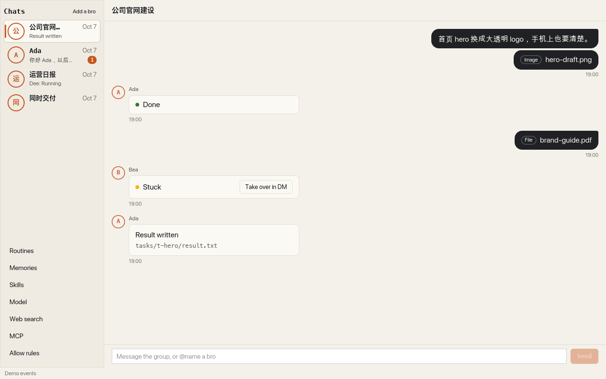
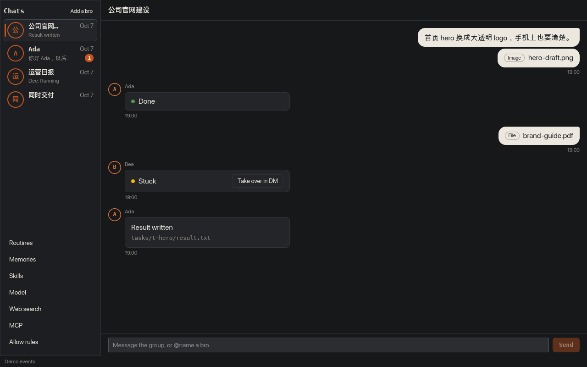

<p align="center">
  <picture>
    <source media="(prefers-color-scheme: dark)" srcset="assets/brand/wordmark-dark.svg">
    
  </picture>
</p>

<p align="center"><b>English</b> | <a href="README.zh-CN.md">简体中文</a></p>

<p align="center">
  <a href="https://github.com/PandaQuQ/robroz/actions/workflows/ci.yml"></a>
</p>

> This repository is the robroz **host** (server): the HTTP API, the runner, the shared contract and the Docker images. The desktop and mobile clients are in [PandaQuQ/robroz-client](https://github.com/PandaQuQ/robroz-client).

Self-hosted multi-agent workspace you drive through chat. Agents (bros) run in Docker sandboxes; approvals and results come back as cards. The host is written in Rust; the native clients are in [robroz-client](https://github.com/PandaQuQ/robroz-client).

See [CHANGELOG.md](CHANGELOG.md) and [docs/install.md](docs/install.md).

## What is robroz

You chat on your own machine with a group of AI bros. You give them work in plain language; they do it in a sandbox on that machine, and they ask you before anything risky.

It is for people who want several AI agents in one workspace they control, and who want to approve risky steps themselves.

<p>
  
  
</p>

<sub>Demo data, shown in the desktop client</sub>

## Features

- **Chat bubbles.** Your messages sit on the right; bro cards sit on the left, grouped by sender. A delivery with a `bot_name` is attached to that bro; a delivery without one stands alone.
- **Group turns.** A message that names no bro gets one reply, from one bro the host picks. Name a bro with `@name` at the start and that bro speaks first; the others may then take a turn or stay quiet.
- **Bros reply to each other.** When a bro replies in a group, the other bros can join in. It stops after two rounds.
- **Follow-ups.** If a bro is still working, you can add to that work instead of starting a new task. In a group, start the message with `@name`; in a direct message, just send it.
- **Bigger tasks in steps.** A bro can split a task into up to 3 steps; the card shows "Step n of m".
- **Direct messages.** Talk one-to-one with a bro.
- **Docker sandbox.** Each job runs in a container on your machine, without network access.
- **Approvals and Allow rules.** Risky steps wait for you. Auto-review checks each card against your allow rules; if no rule allows it, the card stays where the task started and you approve or deny it. For a card in a group, you also get a reminder in your direct message with the bro. Memory and skill changes also wait for you to confirm.
- **Model settings.** Connect any OpenAI-compatible model. A base URL and a model name are enough; the key is optional. You can set this in the client or with environment variables.

You can also use web search (Brave or SearXNG), MCP tools, and scheduled routines. When a step runs long or stalls, a hint appears on the card; the work is not cancelled.

## Roadmap

These are accepted design or in progress. They are **not** shipped on `main`. Details: [docs/design/multi-agent.md](docs/design/multi-agent.md).

- Cancelling a timed-out step or stopping the container.
- Accounts for more than one person on a host.

## Quick start

To run a released host in Docker on Linux, with no Rust toolchain:

```sh
curl -fsSL https://raw.githubusercontent.com/PandaQuQ/robroz/main/deploy/install.sh | sh
```

The script pulls the `v0.2.0` host and runner images from GHCR, writes the token to `~/robroz/secrets/robroz_token`, and serves `127.0.0.1:8790`. Add `-s -- --dry-run` after `sh` to see what it would do first; [docs/docker-host.md](docs/docker-host.md) explains the `docker.sock` risk.

To build from source instead:

You need a Rust stable toolchain (`rustup`, `cargo`) and Docker. To install a published binary or run the host in Docker instead, see [docs/install.md](docs/install.md) and [docs/docker-host.md](docs/docker-host.md). The walk-through there also uses `curl` and `jq`. From the repository root:

```sh
docker build -f runner/Dockerfile -t robroz-runner:local .
cargo run -p robroz-host     # listens on 127.0.0.1:8790, no token required
```

Then start a client from [robroz-client](https://github.com/PandaQuQ/robroz-client); its default host is `http://127.0.0.1:8790`.

The host writes `./robroz.db`, `./data/groups` and `./data/control` by default. A loopback listener needs no token; listening on a non-loopback address without `ROBROZ_TOKEN` or `ROBROZ_TOKEN_FILE` refuses to start.

In the client, click Add a bro (「引入一个 bro」) next to the Chats (「聊天」) heading, open the DM and send a message. That is your first task. With no model configured, the delivery is No model set up yet (「还没设置模型」) and the card offers Set up (「去设置」).

### Configure a model

Open Model (「模型」) in the client, or the Set up (「去设置」) link on a delivery card. Fill in the address and the model name; the key is optional. Saving tests the connection. You can also set environment variables and keep the key in a file outside the repository:

```sh
mkdir -p "$HOME/.config/robroz"
(umask 077 && printf '%s' '<your-key>' > "$HOME/.config/robroz/model-key")
ROBROZ_MODEL_BASE_URL=https://api.openai.com/v1 \
ROBROZ_MODEL=gpt-4o-mini \
ROBROZ_MODEL_KEY_FILE="$HOME/.config/robroz/model-key" \
cargo run -p robroz-host
```

`ROBROZ_MODEL=echo` is a test switch (CI uses it) that echoes the prompt when no complete model is configured. Do not set it in a real deployment.

Other host variables you may want: `ROBROZ_STEP_TIMEOUT_SECS` (default `600`) and `ROBROZ_STALL_SECS` (default `900`) control how soon a long or stalled step shows a hint on the card; `ROBROZ_APPROVAL_TTL_SECS` (default `86400`) is how long an approval card stays open. The full list is in [docs/configuration.md](docs/configuration.md). End-to-end setup, tokens, and a `curl` first-task walk-through are in [docs/install.md](docs/install.md).

## Architecture

Clients from [robroz-client](https://github.com/PandaQuQ/robroz-client) talk to a single-machine host (`robroz-host`) over HTTP and SSE, using the types in `robroz-contract`; the client repository depends on it by git tag (`contract-v*`). The host owns SQLite, model and tool calls, search, MCP, approvals and the container pump. Each task runs in a Docker container (`robroz-runner`) with no network; the container never sees model keys. How the pieces fit together: [docs/architecture.md](docs/architecture.md).

| Path | Crate | Role |
| --- | --- | --- |
| `host/` | `robroz-host` | HTTP API (axum), SQLite, container pump, schedules, model and tool calls, search, MCP, auto-review |
| `runner/` | `robroz-runner` | Task executor inside the container |
| `crates/robroz-contract` | `robroz-contract` | API contract: request and response bodies, event (card) types, task states |
| `crates/robroz-policy` | `robroz-policy` | Permission tiers, outbound metering, blocking lines |
| `crates/robroz-model` | `robroz-model` | OpenAI-compatible `/chat/completions` client with tool calls |
| `crates/robroz-mcp` | `robroz-mcp` | MCP client (stdio and Streamable HTTP) |

"Bro" is the UI name for a bot: code, API and the database still say bot (`botId` / `botName`). The four task states `queued` / `running` / `blocked` / `done` are frozen.

## Documentation

Repository docs are the contract; when another source disagrees, this repository wins. The Chinese user guide lives in [docs/zh-CN/](docs/zh-CN/index.md). Rules for contributors and coding agents: [AGENTS.md](AGENTS.md).

| File | Contents |
| --- | --- |
| [CHANGELOG.md](CHANGELOG.md) | Release notes |
| [docs/zh-CN/](docs/zh-CN/index.md) | Chinese user guide for v0.2.0: install, configuration, daily use, approvals, memory and skills, search and MCP, FAQ, roadmap |
| [docs/install.md](docs/install.md) | Download a release, prerequisites, build, run, connect a model, first task, tests |
| [docs/docker-host.md](docs/docker-host.md) | Run the host in Docker: compose, `docker.sock` risk, same-path mount, token |
| [docs/configuration.md](docs/configuration.md) | All environment variables and defaults |
| [docs/api.md](docs/api.md) | HTTP endpoints and events |
| [docs/concepts.md](docs/concepts.md) | Glossary, task states, cards |
| [docs/permissions.md](docs/permissions.md) | Permission tiers, approvals, takeover, `failure` |
| [docs/design/auto-review.md](docs/design/auto-review.md) | Auto-review and allow rules |
| [docs/memory-and-skills.md](docs/memory-and-skills.md) | Memory, skills, confirm cards |
| [docs/search-and-mcp.md](docs/search-and-mcp.md) | Web search and MCP |
| [client.md](https://github.com/PandaQuQ/robroz-client/blob/main/docs/client.md) | Client UI behaviour, in the client repository |
| [docs/architecture.md](docs/architecture.md) | Components, containers, theming |
| [docs/reference-features.md](docs/reference-features.md) | Reference products and source-reading rules by licence |
| [docs/roadmap-phase2.md](docs/roadmap-phase2.md) | Later roadmap |
| [docs/design/multi-agent.md](docs/design/multi-agent.md) | Group turns, follow-ups, Router and Watchdog design |

Most files under `docs/` are in English. `docs/architecture.md`, `docs/memory-and-skills.md`, `docs/search-and-mcp.md`, `docs/reference-features.md` and `docs/roadmap-phase2.md` are still Chinese-first and will be switched to English in follow-up PRs; `docs/docker-host.md` has both languages. `docs/zh-CN/` is the Chinese user guide and stays in Chinese. Quoted UI strings stay in the language the client currently shows.

## Status

The latest release is [v0.2.0](https://github.com/PandaQuQ/robroz/releases/tag/v0.2.0), a pre-release; see [CHANGELOG.md](CHANGELOG.md). It ships the host as a Linux x86_64 tarball and the `robroz-host` and `robroz-runner` images on GHCR. The desktop and mobile clients are released from [robroz-client](https://github.com/PandaQuQ/robroz-client), which has no release yet; build the client from source against `contract-v0.3.1` or newer. `main` is the development branch after v0.2.0.

In v0.2.0:

- One-command install with Docker ([#197](https://github.com/PandaQuQ/robroz/pull/197), [#204](https://github.com/PandaQuQ/robroz/pull/204)); see [Quick start](#quick-start).
- A message that mentions no bro gets one reply instead of one from every bro ([#198](https://github.com/PandaQuQ/robroz/pull/198); `ROBROZ_SINGLE_RESPONDER=0` restores the old behaviour).
- Bro owners and an optional bro avatar picked by the owner ([#174](https://github.com/PandaQuQ/robroz/pull/174), [#194](https://github.com/PandaQuQ/robroz/pull/194)).
- Group member list, rename, delete and in-group search ([#195](https://github.com/PandaQuQ/robroz/pull/195)).
- Typed status, failure and progress codes; the client turns codes into text ([#186](https://github.com/PandaQuQ/robroz/pull/186), [#189](https://github.com/PandaQuQ/robroz/pull/189)).
- The live stream resumes from a change log after a reconnect, and status cards carry `startedAt` (`contract-v0.3.1`; [#202](https://github.com/PandaQuQ/robroz/pull/202), [#208](https://github.com/PandaQuQ/robroz/pull/208)).
- Stdio MCP processes stay running between tasks, one per server per group ([#188](https://github.com/PandaQuQ/robroz/pull/188), [#190](https://github.com/PandaQuQ/robroz/pull/190)).

Known issues are listed in the [v0.2.0 release notes](https://github.com/PandaQuQ/robroz/releases/tag/v0.2.0). Long-lived sessions that reuse one container were in the v0.2 scope but are not in v0.2.0.

**Moved to v0.3:** layered memory (a short always-loaded note plus recall by relevance), a delegation tree where a parent task finishes only after its subtasks report back, and per-session approval levels with questions answered mid-turn.

## Development

Run the same commands as CI before opening a pull request:

```sh
cargo test -p robroz-mcp --features fixture
cargo test -p robroz-host -p robroz-contract -p robroz-policy -p robroz-runner
scripts/e2e.sh   # needs Docker, curl and jq
```

CI runs the host tests and the end-to-end script on Linux. A `cargo-deny` job checks that new dependencies use an AGPL-compatible licence and come from a known registry; advisories are reported and do not block the merge. Run the same checks locally after installing [cargo-deny](https://github.com/EmbarkStudios/cargo-deny):

```sh
cargo deny check licenses bans sources
cargo deny check advisories   # reported, does not block merging
```

## Contributing

- One pull request per change.
- Every contributor must sign the [Contributor License Agreement](CLA.md) once: tick the CLA checkbox in the pull request template, or add the CLA line from `CLA.md` to the pull request body. Pull requests without it are not merged.
- Commit messages and pull request titles and bodies are in English and follow [Conventional Commits](https://www.conventionalcommits.org/): `feat(host): …`, `fix(client): …`, `docs: …`. Pull requests are squash-merged with the title as the commit message.
- The contract is add-only: new card types, endpoints and optional fields are fine; existing fields, the task states and `botId` / `botName` are frozen.
- `main` is protected: changes land only through a pull request, and the four CI checks (`host`, `cla`, `e2e`, `cargo-deny`) must pass before merge. No one can bypass this, admins included.
- No force-push. If your branch is behind, merge `main` into it.
- Never commit `.env`, `.pem`, `.dev.vars`, keys or tokens.
- Keep `README.md` and `README.zh-CN.md` in sync; change both in the same pull request.

The full rules are in [AGENTS.md](AGENTS.md).

## License

SPDX-License-Identifier: `AGPL-3.0-only`

robroz is licensed under the [GNU Affero General Public License v3.0 only](LICENSE). If you modify robroz and let others use it over a network, you must offer them your modified source code (AGPL section 13).

The host in this repository is also available under a commercial licence for closed-source or proprietary use; the clients are AGPL-3.0 only. See [COMMERCIAL.md](COMMERCIAL.md). For commercial licensing, [contact the author](https://github.com/PandaQuQ).

Contributions are accepted under the [Contributor License Agreement](CLA.md).
