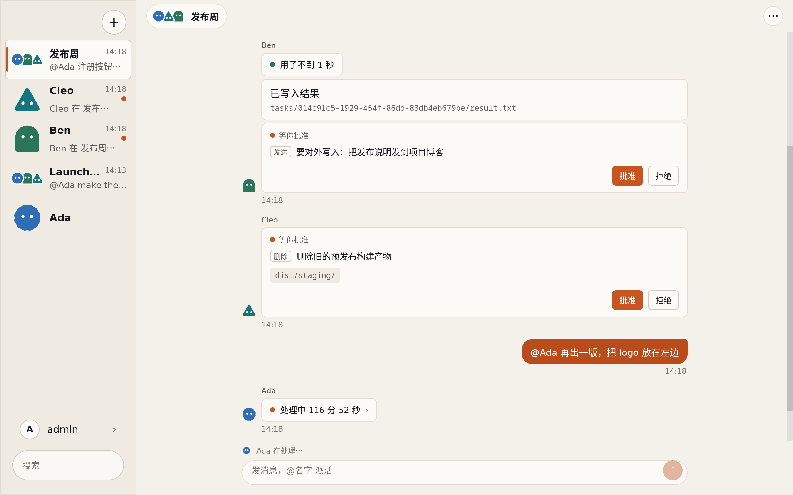
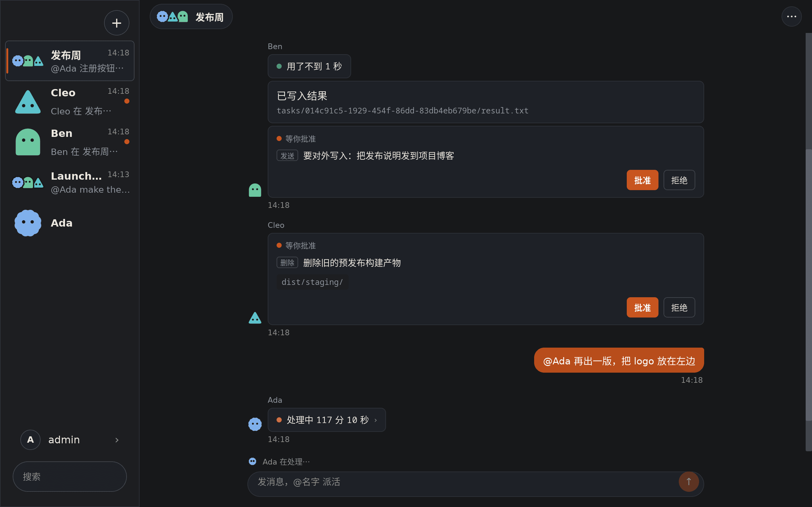

<p align="center">
  <picture>
    <source media="(prefers-color-scheme: dark)" srcset="assets/brand/wordmark-dark.svg">
    
  </picture>
</p>

<p align="center"><a href="README.md">English</a> | <b>简体中文</b></p>

<p align="center">
  <a href="https://github.com/PandaQuQ/robroz/actions/workflows/ci.yml"></a>
</p>

> 本仓库是 robroz **宿主机**（服务端）：HTTP 接口、runner、共享契约和 Docker 镜像。桌面和手机客户端在 [PandaQuQ/robroz-client](https://github.com/PandaQuQ/robroz-client)。

自托管的多智能体工作台，通过对话进行操作。智能体（bro）在 Docker 沙箱中运行；审批和结果以卡片返回对话。宿主机用 Rust 编写；原生客户端在 [robroz-client](https://github.com/PandaQuQ/robroz-client)。

见 [CHANGELOG.md](CHANGELOG.md) 和 [docs/install.md](docs/install.md)。

## 概览

在自己的机器上，通过对话向一组 AI bro 布置工作。工作以自然语言描述，在本机沙箱中执行；遇有风险的步骤会先征求批准。

适合希望在自己控制的工作区中使用多个 AI 智能体、并由自己批准风险步骤的用户。

<p>
  
  
</p>

<sub>桌面客户端中的「发布周」群，浅色与深色主题。演示数据。</sub>

## 功能

- **聊天气泡。** 你自己的消息显示在右边；bro 的卡片显示在左边，按发送者分组。带 `bot_name` 的交付卡挂到对应的 bro 下面；没有 `bot_name` 的单独一条。
- **群轮次。** 没有点名时，群消息只由宿主选出的一个 bro 回复。消息开头用 `@name` 点名的那个 bro 先说，其他 bro 可以接着发言，也可以保持沉默。
- **bro 相互回复。** bro 在群里回复后，其他 bro 也可以接着回复，最多两轮后停止。
- **追问。** 如果一个 bro 仍在执行任务，可以在该任务上补充说明，而不新开任务。在群里以 `@name` 开头；在私聊里直接发送即可。
- **分步任务。** 最多拆成 3 步，卡片显示「n/m 步」。
- **私聊。** 可以和一个 bro 单独对话。
- **Docker 沙箱。** 每份工作在你机器上的一个容器里运行，容器没有网络。
- **审批和放行规则（Allow rules）。** 有风险的步骤会先征求你的批准。自动审核会按你的放行规则检查每张卡；没有规则放行时，卡留在任务发起的地方，由你批准或拒绝。卡在群里时，你和这个 bro 的私聊里还会收到一条提醒。记忆和技能的变更也要先经你确认。
- **模型设置。** 可以连接任意 OpenAI 兼容的模型。填写地址和模型名即可完成配置，密钥可选。可以在客户端设置，也可以使用环境变量。

还可以使用联网搜索（Brave 或 SearXNG）、MCP 工具和例行任务。某一步运行过久或停滞时，卡片上会出现一行提示；工作本身不会被取消。

## 路线图

以下项目为已接受的设计，或正在进行，**尚未**合并到 `main`。细节见 [docs/design/multi-agent.md](docs/design/multi-agent.md)。

- 超时后取消步骤或停掉容器。
- 一台 host 上多人共用的账号。

## 安装

在 Linux 上用 Docker 安装已发布的宿主机，不需要 Rust 工具链：

```sh
curl -fsSL https://raw.githubusercontent.com/PandaQuQ/robroz/main/deploy/install.sh | sh
```

脚本从 GHCR 拉取 `v0.2.0` 的 host 和 runner 镜像，把令牌写到 `~/robroz/secrets/robroz_token`，并监听 `127.0.0.1:8790`。若要先查看将执行的操作，在 `sh` 后面加 `-s -- --dry-run`；`docker.sock` 的风险见 [docs/docker-host.md](docs/docker-host.md)。

从源码构建：

需要 Rust stable 工具链（`rustup`、`cargo`）和 Docker。若要安装已发布的二进制，或用 Docker 运行宿主机，见 [docs/install.md](docs/install.md) 和 [docs/docker-host.md](docs/docker-host.md)。那里的逐步示例还用到 `curl` 和 `jq`。在仓库根目录：

```sh
docker build -f runner/Dockerfile -t robroz-runner:local .
cargo run -p robroz-host     # 监听 127.0.0.1:8790，不用令牌
```

宿主机默认写入 `./robroz.db`、`./data/groups` 和 `./data/control`。监听本机回环地址时可以不设令牌；监听非回环地址却没有 `ROBROZ_TOKEN` 或 `ROBROZ_TOKEN_FILE` 时，会拒绝启动。

## 快速开始

从 [robroz-client](https://github.com/PandaQuQ/robroz-client) 启动客户端，默认连接 `http://127.0.0.1:8790`。

在客户端 Chats（「聊天」）标题旁点 Add a bro（「引入一个 bro」），打开私聊并发送一条消息，即为第一个任务。尚未配置模型时，交付是 No model set up yet（「还没设置模型」），卡片上有 Set up（「去设置」）。

### 配置模型

在客户端打开 Model（「模型」），或点交付卡上的 Set up（「去设置」）。填写地址和模型名即可，密钥可选。保存时会测试连接。也可以使用环境变量，并把密钥放在仓库外的文件里：

```sh
mkdir -p "$HOME/.config/robroz"
(umask 077 && printf '%s' '<你的密钥>' > "$HOME/.config/robroz/model-key")
ROBROZ_MODEL_BASE_URL=https://api.openai.com/v1 \
ROBROZ_MODEL=gpt-4o-mini \
ROBROZ_MODEL_KEY_FILE="$HOME/.config/robroz/model-key" \
cargo run -p robroz-host
```

`ROBROZ_MODEL=echo` 是测试开关（CI 会使用），在没有配齐模型时把 prompt 原样写成结果。正式部署不要设置此项。

其他常用的宿主机变量：`ROBROZ_STEP_TIMEOUT_SECS`（默认 `600`）和 `ROBROZ_STALL_SECS`（默认 `900`）控制卡片上多久出现「运行过久或停滞」的提示；`ROBROZ_APPROVAL_TTL_SECS`（默认 `86400`）是审批卡的有效期。完整列表见 [docs/configuration.md](docs/configuration.md)。从令牌到用 `curl` 完成第一个任务，见 [docs/install.md](docs/install.md)。

## 文档

仓库中的文档为契约；与其他来源不一致时，以本仓库为准。中文使用文档在 [docs/zh-CN/](docs/zh-CN/index.md)。贡献者和编码 agent 的规则见 [AGENTS.md](AGENTS.md)。

| 文件 | 内容 |
| --- | --- |
| [CHANGELOG.md](CHANGELOG.md) | 版本说明 |
| [docs/zh-CN/](docs/zh-CN/index.md) | v0.2.0 中文使用文档：安装、配置、日常使用、审批、记忆和技能、搜索和 MCP、常见问题、路线图 |
| [docs/install.md](docs/install.md) | 下载发行包、准备、构建、运行、接模型、第一个任务、测试 |
| [docs/docker-host.md](docs/docker-host.md) | 用 Docker 运行宿主机：compose、`docker.sock` 风险、同路径挂载、令牌 |
| [docs/configuration.md](docs/configuration.md) | 全部环境变量和默认值 |
| [docs/api.md](docs/api.md) | HTTP 接口和事件 |
| [docs/concepts.md](docs/concepts.md) | 术语、任务状态、卡片 |
| [docs/permissions.md](docs/permissions.md) | 三级权限、审批、接管、`failure` |
| [docs/design/auto-review.md](docs/design/auto-review.md) | 自动审核设计和放行规则 |
| [docs/memory-and-skills.md](docs/memory-and-skills.md) | 记忆、技能、确认卡 |
| [docs/search-and-mcp.md](docs/search-and-mcp.md) | 联网搜索和 MCP |
| [client.md](https://github.com/PandaQuQ/robroz-client/blob/main/docs/client.md) | 客户端界面行为，在客户端仓库 |
| [docs/architecture.md](docs/architecture.md) | 各部分分工、容器、外观层 |
| [docs/reference-features.md](docs/reference-features.md) | 参考产品和读源码的规则（按许可证分） |
| [docs/roadmap-phase2.md](docs/roadmap-phase2.md) | 后续路线图 |
| [docs/design/multi-agent.md](docs/design/multi-agent.md) | 群轮次、追问、Router 和 Watchdog 设计 |

`docs/` 下大多数文件是英文。`docs/architecture.md`、`docs/memory-and-skills.md`、`docs/search-and-mcp.md`、`docs/reference-features.md` 和 `docs/roadmap-phase2.md` 目前仍以中文为主，会在后续 PR 里改成英文为主；`docs/docker-host.md` 中英文都有。`docs/zh-CN/` 是中文使用文档，保持中文。引用的界面文案仍按客户端当前显示的语言写。

## 状态

最新的发布是 [v0.2.0](https://github.com/PandaQuQ/robroz/releases/tag/v0.2.0)，预发布版本，见 [CHANGELOG.md](CHANGELOG.md)。它发布 host：一个 Linux x86_64 压缩包，以及 GHCR 上的 `robroz-host` 和 `robroz-runner` 镜像。桌面和手机客户端从 [robroz-client](https://github.com/PandaQuQ/robroz-client) 发布，该仓库尚未发布版本；请从源码构建，基于 `contract-v0.3.1` 或更新。`main` 是 v0.2.0 之后的开发分支。

v0.2.0 包括：

- 用 Docker 一条命令安装（[#197](https://github.com/PandaQuQ/robroz/pull/197)、[#204](https://github.com/PandaQuQ/robroz/pull/204)），见[安装](#安装)。
- 没有点名任何 bro 的消息只得到一条回复，不再每个 bro 都回（[#198](https://github.com/PandaQuQ/robroz/pull/198)；`ROBROZ_SINGLE_RESPONDER=0` 恢复旧行为）。
- bro 主人，以及主人选择的可选 bro 头像（[#174](https://github.com/PandaQuQ/robroz/pull/174)、[#194](https://github.com/PandaQuQ/robroz/pull/194)）。
- 群成员列表、改名、删群和群内搜索（[#195](https://github.com/PandaQuQ/robroz/pull/195)）。
- 状态、失败和进度用编码表示，客户端把编码转成文字（[#186](https://github.com/PandaQuQ/robroz/pull/186)、[#189](https://github.com/PandaQuQ/robroz/pull/189)）。
- 事件流断线后按变更日志续上，状态卡带 `startedAt`（`contract-v0.3.1`；[#202](https://github.com/PandaQuQ/robroz/pull/202)、[#208](https://github.com/PandaQuQ/robroz/pull/208)）。
- stdio MCP 进程在任务之间保持运行，每个群每个 server 一个（[#188](https://github.com/PandaQuQ/robroz/pull/188)、[#190](https://github.com/PandaQuQ/robroz/pull/190)）。

已知问题见 [v0.2.0 发布说明](https://github.com/PandaQuQ/robroz/releases/tag/v0.2.0)。长会话复用同一个容器原本在 v0.2 范围里，但没有进入 v0.2.0。

**已调整至 v0.3：** 分层记忆（常驻一份短笔记，其余按相关度召回）；派活树，子任务都交回后上游任务才算完成；会话级审批档位，以及回合中途提问、答完接着跑。

## 架构

[robroz-client](https://github.com/PandaQuQ/robroz-client) 中的客户端使用 `robroz-contract` 的类型，通过 HTTP 和 SSE 连接到单机宿主机（`robroz-host`）；客户端仓库按 git tag（`contract-v*`）依赖它。宿主机负责 SQLite、模型和工具调用、搜索、MCP、审批和容器泵。每个任务在一个没有网络的 Docker 容器（`robroz-runner`）中运行，容器看不到模型密钥。各部分如何配合见 [docs/architecture.md](docs/architecture.md)。

| 路径 | crate | 作用 |
| --- | --- | --- |
| `host/` | `robroz-host` | HTTP 接口（axum）、SQLite、容器泵、定时、模型和工具调用、搜索、MCP、自动审核 |
| `runner/` | `robroz-runner` | 容器里的任务执行器 |
| `crates/robroz-contract` | `robroz-contract` | 接口契约：请求体和返回体、事件（卡片）类型、任务状态 |
| `crates/robroz-policy` | `robroz-policy` | 权限分级、出网计次、阻塞行 |
| `crates/robroz-model` | `robroz-model` | OpenAI 兼容 `/chat/completions` 客户端，含工具调用 |
| `crates/robroz-mcp` | `robroz-mcp` | MCP 客户端（stdio 和 Streamable HTTP） |

「bro」是界面上对 bot 的称谓：代码、接口和数据库中仍称为 bot（`botId` / `botName`）。四个任务状态 `queued` / `running` / `blocked` / `done` 已冻结。

## 开发

提交 pull request 前，请运行与 CI 相同的命令：

```sh
cargo test -p robroz-mcp --features fixture
cargo test -p robroz-host -p robroz-contract -p robroz-policy -p robroz-runner
scripts/e2e.sh   # 需要 Docker、curl 和 jq
```

CI 在 Linux 上运行宿主机测试和端到端脚本。`cargo-deny` 会检查新依赖是否使用与 AGPL 兼容的许可证、是否来自已知的 registry；安全公告只报告，不阻止合并。本地运行同样的检查（先安装 [cargo-deny](https://github.com/EmbarkStudios/cargo-deny)）：

```sh
cargo deny check licenses bans sources
cargo deny check advisories   # 只报告，不挡合并
```

## 参与贡献

- 一个 pull request 只做一件事。
- 每位贡献者都要签一次[贡献者许可协议](CLA.md)：勾选 pull request 模板里的 CLA 框，或把 `CLA.md` 里那行声明加到正文里。没有签署的 pull request 不会合并。
- 提交信息、pull request 标题和正文都用英文，按 [Conventional Commits](https://www.conventionalcommits.org/) 写：`feat(host): …`、`fix(client): …`、`docs: …`。pull request 用 squash merge 合并，标题就是合并后的提交信息。
- 契约只增不改：可以新增卡片类型、接口和可选字段；已有字段、任务状态和 `botId` / `botName` 都冻住不改。
- `main` 受保护：只能通过 pull request 合入，四个 CI 检查（`host`、`cla`、`e2e`、`cargo-deny`）全部通过才能合并，管理员也不能绕过。
- 不 force-push。分支落后时把 `main` merge 进来。
- 不提交 `.env`、`.pem`、`.dev.vars`、密钥或令牌。
- `README.md` 和 `README.zh-CN.md` 保持一致，在同一个 pull request 里一起改。

完整规则见 [AGENTS.md](AGENTS.md)。

## 许可证

SPDX-License-Identifier: `AGPL-3.0-only`

robroz 采用 [GNU Affero 通用公共许可证 v3.0 only](LICENSE)。修改了 robroz 并通过网络给别人使用的，必须向这些用户提供改过的源码（AGPL 第 13 条）。

本仓库的宿主机用于闭源或专有用途时，可以另外取得商业授权；客户端只用 AGPL-3.0。见 [COMMERCIAL.md](COMMERCIAL.md)。商业授权请[联系作者](https://github.com/PandaQuQ)。

贡献按[贡献者许可协议](CLA.md)接收。
