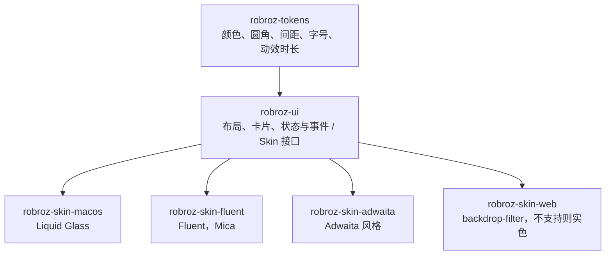

# 第二期路线图

## 目标与前提

robroz 要做成一个开源版的 Grok Bot：用 Rust 自研，交互是 IM，不是 IDE。第一期只在一台电脑上跑，范围是节点 1 到节点 7。这份路线图只排列第一期上线之后、为补齐「完整的 Grok Bot 体验」还要做的事。条目来自已合入的 `docs/reference-features.md` 中「第一期？」为「否」或「后续」的行，再加上 2026-11-20 已拍板、必须进入第二期的项。参考 Comma、OpenBot、OpenMausBot 时，只许看它们的 README、`docs/`、许可证和公开截图，不许看、抄或翻译它们的源码。

## 排期原则

- 第一期先做完。第二期任何条目都不能在第一期上线之前插队。
- 第一期等于节点 1 到节点 7。节点 7 的联调先写成 GitHub Actions 里 Ubuntu 机器上的端到端测试，用假模型走完整条流程：建任务、跑沙箱、审批、重启后恢复，并且确认不重放改动。真机测试等 Panda 开口再开机。
- 契约只开一个口子：可以新增卡片类型和接口，已有字段一个都不改，包括字段名、类型、含义和已有枚举值。改已有字段要 Panda 拍板。
- 本文件不写日期和工时。下面的「建议顺序」只反映依赖，不表示工期。

## 客户端分层结构

客户端拆成三层。布局、卡片结构和状态在各平台上相同；配色一律用 robroz 自己的品牌色，只换表面材质、窗口边框和控件手感。

- **`robroz-tokens`**：一份设计参数源文件，记录颜色、圆角、间距、字号和动效时长。从这一份生成两样东西：给 Rust 用的常量，和给网页版用的 CSS 变量。品牌配色只在这里定义。
- **`robroz-ui`**：通用框架。布局，选项卡、审批卡、草稿卡、例行任务列表、状态卡和交付卡，以及状态和事件处理，都放在这里。它定义一个外观接口（Skin），统一管颜色、圆角、描边、阴影、材质和控件手感。组件只从这个接口取值，不写死任何样式，也不知道自己跑在哪个系统上。框架层不直接读写本地文件，也不直接开线程，这样同一套代码以后才能编成网页版。
- **`robroz-skin-*`**：一个平台一个外观库。各自负责材质、窗口边框、控件手感，以及跟随系统浅色 / 深色。需要调用系统接口的窗口效果（毛玻璃、Mica）只放在对应平台的外观库里。网页版的玻璃效果用 CSS `backdrop-filter`，浏览器不支持时退回实色。打包时按 `cfg(target_os)` 或 cargo feature 只编进其中一个。

crate 名固定为：`robroz-skin-macos`（Liquid Glass）、`robroz-skin-fluent`（Fluent，Mica）、`robroz-skin-adwaita`（Adwaita 风格）、`robroz-skin-web`。

这三层本身的落地时机如下。前两行还不是第二期，列在这里是为了把分界说清楚。

| 时机 | 做什么 |
| --- | --- |
| 今天（第一期，前端四张卡的那个 PR） | `robroz-tokens`、`robroz-ui` 和一套默认实色外观，放在同一个 PR 里 |
| 节点 7 的端到端测试在 CI 上跑绿之后 | 桌面外观库，一个平台一个 PR，顺序是 macos → fluent → adwaita。这是节点 7 之后、第二期之前或开头的工作 |
| 第二期 | `robroz-skin-web` 和网页版 |

网页版用 iced 编译成 WebAssembly，同一套 `robroz-ui` 跑在浏览器里，只换成 `robroz-skin-web`。客户端和宿主机之间仍然只走 HTTP 和事件流。

## 第二期条目

用户可见行为的原文见 `docs/reference-features.md`。下表不重复来源链接。「契约影响」只写打算新增的卡片或接口，不改已有字段。

| 条目 | 用户能看到什么 | 依赖 | 契约影响（新增什么） | 建议顺序 |
| --- | --- | --- | --- | --- |
| 例行任务补全 | 在第一期的列表和暂停之外，能看运行历史，能立刻跑一次，能编辑。对话里创建时出一张可编辑 / 暂停的卡片；过期或已变更的提案要重新出卡，不能再点旧卡。 | 第一期已有的 `GET` 列表和 `PATCH paused` | 新增运行历史、立刻跑一次、编辑的接口；不改已有 `Schedule` 字段，也不改 `POST /api/schedules` 的返回 | 1 |
| 技能库 | 可复用的技能说明，在对话里启用；保存或授予前要用户确认。技能本身不等于对外系统的权限。 | 无额外后台依赖 | 新增技能的列表与启用接口；保存或授予前新增确认用卡片 | 2 |
| 长期记忆按类型存放 | 用户资料、工作习惯、项目记录分开存，可查看、可改、可忘掉。Bot 形成的条目要用户确认后才收下。 | 无额外后台依赖 | 新增按类型查看、修改、遗忘的接口；Bot 提议收下时新增确认用卡片 | 3 |
| 项目日志 | 按日或按项目留下工作记录，人可以打开看，可以撤销改动。 | 宜在长期记忆之后 | 新增日志查看与撤销接口 | 4 |
| 网页版与 `robroz-skin-web` | 浏览器里使用同一套界面：布局、卡片和状态与桌面版相同，表面换成网页外观。 | `robroz-ui` 已守住不直接读写本地文件、不直接开线程；可与 1–4 并行 | 原则上仍走现有 HTTP 与事件流，不为此改已有字段 | 5 |
| 连接器（MCP） | 把常用应用接到 bot。OAuth 由用户完成；授权范围按 bot 授予。未授权的应用不能用。第一期未做的 MCP 网关在这里补上。 | 无，但是事件触发要等它 | 新增连接、授权与按 bot 授予范围的接口；新增 MCP 网关。不把未授权的应用暴露给执行器 | 6 |
| 公开网页检索并注明出处 | 搜索或阅读公开网页，并引用 URL。检索查询按用户可见的「搜索网页 / 阅读页面」呈现。 | 宜在连接器之后或与之衔接；第一期只有按任务计数的出网 GET | 新增检索过程的展示事件，以及带 URL 出处的展示。不改节点 4 已有的出网计数字段 | 7 |
| 事件触发 / Webhook | 收件箱、仓库或已连接应用有约定变化时才叫醒 bot；安静时段不跑大模型。第一期只有 cron。 | 连接器或至少要有 webhook 入口 | 新增触发器（含 webhook）的创建与列表接口，并与例行任务列表对齐 | 8 |
| 频道 / 房间组织 | 工作、日常、项目分频道，各有自己的记录、共用说明、工作目录、应答规则和可编辑的 bot 名单。未点名的消息可由决策模型选一个合适的 bot，拿不准就交给房间负责人。2026-11-20 从第一期移入。 | 第一期已有分群；自动选 Bot 和频道级说明是本项要补的部分 | 新增频道级说明、工作目录、应答规则和可编辑名单等接口。不改已有群字段 | 9 |
| 按 bot 分配独立电脑 | 每个 bot 可单独选择运行处。第一期仍是每个群一个 Docker 加共享卷；第二期要做到每个 bot 一台独立电脑，更后的形态是按 bot 单独虚拟机。 | 宜在频道组织之后或与之衔接 | 新增为 bot 分配运行处的接口。不改已有「每群一个目录」字段的含义 | 10 |
| 把 Bot 当联系人管理 | 侧栏像聊天列表：置顶、未读、改资料、复制、隐藏、删除；可暂停某个 bot、整个部门或全部 bot，恢复后数据和例行任务还在。第一期只有群列表，没有 Bot 详情页。 | 无强依赖，宜在频道组织前后 | 新增 Bot 资料、暂停与恢复等接口，以及 Bot 详情页所需的读取接口 | 11 |
| 群聊里多个 Bot 分工 | 被点到的 Bot 用自己的名字回答，不由另一个 Bot 代述。可把工作交给队友，按接收方自己的权限跑。第一期只做建群、拉 Bot、派任务。 | 宜在频道组织之后 | 新增 Bot 互派任务的接口；权限仍按接收方计算 | 12 |
| 对话里的通用组件 | 在已有卡片之外，用可交互组件代替纯文字，例如画廊、选项板。第一期已有状态卡、交付卡、选项卡、审批卡、草稿卡和例行任务列表。 | 只新增卡片类型，可与其它项并行 | 只新增卡片类型。不改已有卡片字段 | 13 |
| 用量可见、可设上限 | 能看到用量；可为整台机器或单个 bot 设每日 / 每月上限。到上限默认只拦住无人值守的例行任务，本人发的消息仍可走。到 80% 只改变用量条颜色，不弹窗。许可制月度支出上限不参考。 | 无强依赖 | 新增用量查询与上限设置接口 | 14 |
| 整队导入与分享 | 用一份说明文件安装一组 bot、频道和建议例行任务；连接默认关闭，例行任务默认暂停，不携带会话、记忆、密钥或电脑权限。分享时只带角色、技能和要用的应用名。 | 技能库、例行任务、频道组织 | 新增导入与分享接口。导入不得写入会话、记忆、密钥或电脑权限 | 15 |
| 云端电脑和浏览器代办 | 看它的桌面或浏览器，必要时由用户接管（登录、验证码）。 | 按 bot 分配独立电脑已经落地 | 新增桌面或浏览器预览、以及接管相关的事件或接口 | 16 |
| 文件树、终端、桌面流 | 在卡片或侧栏里浏览文件树、打开终端、看实时桌面。第一期明确不做。 | 按 bot 分配独立电脑已经落地；宜在「云端电脑和浏览器代办」之后 | 新增文件树、终端和桌面流相关的事件或接口。桌面流不复用第一期的轮询通道假设 | 17 |
| 可发布的页面或小应用 | 用户让 agent 做一个可打开的预览页，确认后再发布；对外行动仍要在产品界面里点一下。 | 无强依赖，宜较后 | 新增预览与发布接口；对外发布仍走审批，不改已有审批字段 | 18 |
| 本地 agent 按 bot 接入 | 侧栏里每个 bot 可以接到本机已登录的命令行，或设置里接入的兼容引擎；可在对话中途换模型。数据和密钥默认留在本机目录。 | 不默认替换第一期的 Rust runner，是否做、如何并存要另定 | 若做，只新增按 bot 配置引擎的接口，不改已有任务状态字段 | 19 |

## 不做 / 待定

- 不把第一期的 Rust runner 默认换成外部 CLI。「本地 agent 按 bot 接入」若要做，只能作为可选接入方式另议。
- 下列客户端形态在 `docs/reference-features.md` 的附录里仍是待定，不列入第二期表：Apple Watch、iPhone Task sheet / iPad 分栏、嵌入式 Task 面板、macOS / Windows Quick Chat、SSH 终端客户端。
- 多租户不在第一期，也还没有排进第二期，等 Panda 或 PM 另定。
- 域名买不买不在本路线图里，等 Panda 有空再定。
- OpenMausBot `enterprise/` 以及仅在商业许可下出现的能力（白标、公司 SSO、托管登录适配、许可制月度支出上限等）不参考、不列入。

## 和第一期的边界

第一期上线之前，上面的第二期条目都不开工。节点 7 的端到端测试在 CI 上跑绿之前，三个桌面外观库也不开工。

第一期要做到的，到此为止：

- 单机私有化。每个群一个本机 Docker 沙箱，群目录共享挂到 `/workspace`，做完删掉容器。
- 宿主机编排、三级权限、私聊接管、cron 定时和简报。没有 webhook，没有 MCP 网关，没有按 bot 单独虚拟机。
- 客户端是 iced 原生包，Windows、Linux、macOS 各出一个，不套网页。今天把 `robroz-tokens`、`robroz-ui` 和默认实色外观做进四张卡的 PR。
- 卡片方面：状态卡、交付卡，以及新增的选项卡（`choice`，回传 `{"choice":[ids]}`，单选也传数组）、审批卡、草稿卡、例行任务列表。例行任务第一期只做列表和暂停。状态卡保持冻结。
- 五项体验行为：关键节点汇报进度、收到任务先短确认、外部内容只当数据、被打断的修改不自动重跑、没变化时不打扰。

第一期不做、留给本路线图的，包括：长期记忆、技能库、连接器和 MCP 网关、每个 bot 一台独立电脑、频道 / 房间组织、事件触发和 webhook、例行任务的运行历史 / 立刻跑一次 / 编辑、网页版和 `robroz-skin-web`，以及上表其余条目。
