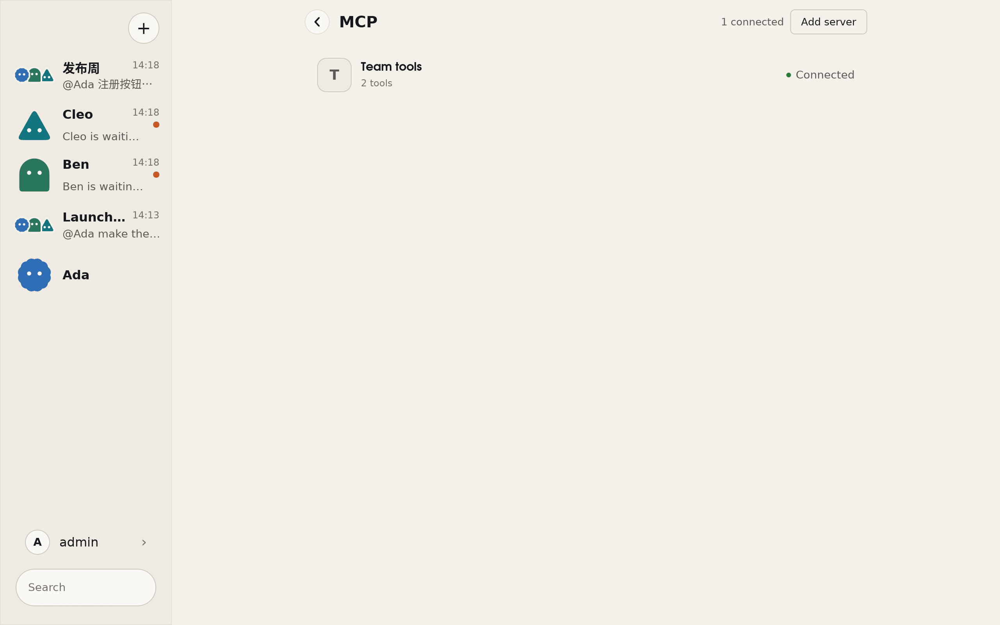

# 搜索和 MCP

host 可以替 bro 做两件对外的事：上网搜索或读取公开网页，以及接上 MCP 服务器。这两件事都在 host 上进行，任务容器本身仍然没有网络，也拿不到密钥。

字段、接口和报错的精确说明见 [docs/search-and-mcp.md](../search-and-mcp.md)。

## 联网搜索能做什么

接了模型之后，bro 可以请 host：

- 用你选好的服务搜索公开网页
- 用 GET 读某一个页面，并把内容转成纯文字。只接受普通的网页地址，不会去读本机或内网地址

这两件事都算在每个任务的出门次数里，默认最多 8 次，超了任务就会「没做成」。见 [权限和审批](permissions.md)。

服务由你自己选、自己填，密钥留在本机：可以选 [Brave Search](https://brave.com/search/api/)，或自建一个 [SearXNG](https://docs.searxng.org/) 实例。

还没设置时，bro 若去搜索，结果开头会出现「还没设置联网搜索」。

## 在客户端里填

在「设置 → bro → 联网搜索」打开。

1. 先选「Brave」或「SearXNG」。
2. 选 Brave 就填密钥，输入框里的字是遮住的。保存后不再显示原文，只显示「已填 · 」加密钥的最后 4 位，旁边一个「清除」。
3. 选 SearXNG 就填实例地址，比如 `http://127.0.0.1:8888`。
4. 点「保存」（在输入框里按回车也行）。保存后自动试连一次，按钮旁边先显示「试连中…」，然后是：
   - 「能用了」：可以搜了。
   - 「已保存，但连不上：原因」：设置已经存下，但这次没连通。按原因检查密钥或地址。
   - 「没保存：原因」：这次没存进去，原来的设置不变。

忘了填会直接提示「请填写 key」或「请填写地址」。

**清除**：点了不会马上生效，而是标成「保存后删除」，旁边有「撤销」。点「保存」才真正清掉这一页存过的搜索设置。如果 host 启动时设了环境变量，之后改回用环境变量；没有的话，页面回到「还没设置联网搜索」。

标题旁边如果有「来自环境变量」，说明现在生效的设置全部来自 host 的环境变量。在这一页保存之后，这个标签就消失。这一页清不掉环境变量里的设置，要改那些，得改环境变量再重启 host。

bro 搜索时发现还没设置，任务一般照样会写出结果。这时交付卡上会出现「去设置」按钮，路径下面有一行灰字「这次没联网搜索：还没设置」。点「去设置」就打开这一页。如果任务同时没做成，卡上同样有「去设置」，但没有路径和那行灰字。

## 不用客户端，怎么填，怎么试

客户端那一页背后用的就是设置接口。**通过设置接口保存的值优先于环境变量**，而且逐项比较：哪一项在设置接口里填过就用它，没填的那一项再退回环境变量。用设置接口改完不用重启 host；改环境变量要重启才生效。

```sh
B=http://127.0.0.1:8790
T="Authorization: Bearer <你的令牌>"

# Brave：在 Brave Search API 后台拿订阅密钥
curl -X PUT $B/api/settings/search -H "$T" \
  -H 'Content-Type: application/json' \
  -d '{"provider":"brave","key":"<你的 Brave 密钥>"}'

# SearXNG：填实例地址，不用密钥
curl -X PUT $B/api/settings/search -H "$T" \
  -H 'Content-Type: application/json' \
  -d '{"provider":"searxng","url":"https://<你的 SearXNG 地址>"}'

# 试连：真的发一次查询。成功是 {"ok":true}，失败会带上原因
curl -X POST $B/api/settings/search/test -H "$T"
```

接口不会把密钥原文返回来，只告诉你有没有填、以及末四位。只想换密钥就只传 `key`；要清掉某一项、改回用环境变量，把那一项传 `null`。

也可以改用环境变量：Brave 设 `ROBROZ_SEARCH_PROVIDER=brave` 和 `ROBROZ_BRAVE_KEY`；SearXNG 设 `ROBROZ_SEARCH_PROVIDER=searxng` 和 `ROBROZ_SEARXNG_URL`。用安装脚本装的 host，写在 `compose.override.yml` 里，见 [配置](configuration.md#用安装脚本装的-host)。

注意：

- 密钥只放在 host 本机，不要提交，也不要发到群里。
- SearXNG 实例要在自己的 `settings.yml` 里把 `json` 加进 `search.formats`，否则试连会失败。
- 通过设置接口填的地址必须以 `http://` 或 `https://` 开头；环境变量里的地址启动时不检查，写错了要等试连或搜索时才发现。

## MCP：把外部工具接给 bro

MCP 用来把外部工具接到 host 上。可以接两种服务器：在 host 本机用命令拉起来的（stdio），或用 HTTP 访问的。

最省事的是在桌面客户端里配：「设置 → bro → MCP」。手机端的 MCP 页只能看，不能增删改。



*桌面客户端的 MCP 页（英文界面）：已连接一台名为 Team tools 的服务器，显示 2 tools，状态为 Connected。演示数据。*

### 在客户端里配

还没有服务器时，页面显示「还没有 MCP 服务器」。点标题右边的「加一台」：

1. 「名称」：给它起个名字，不能和别的服务器重名，最多 80 个字。
2. 选「stdio」（在本机用命令拉起来）或「HTTP」（用地址访问）。
3. 选 stdio 就填「命令」和「参数（用空格分开）」。参数按空格切开，所以单个参数里不能带空格。选 HTTP 就填「地址」，要以 `http://` 或 `https://` 开头。
4. 需要密钥就点「加一项密钥」，填「密钥名称」和「密钥」，再选它是作为「环境变量」还是「请求头」交给服务器（stdio 默认环境变量，HTTP 默认请求头）。
5. 点「保存」。保存后会自动试连一次，名字下面先显示「试连中…」，然后是「能用了 · 几个工具」，或「连不上：原因」。stdio 服务器这时会先展开命令批准区，见下面。

列表里每台服务器一行：首字母图标、名字，下面一行灰字写着有几个工具（还没连过时写「还没数过」）。右边是「连接」按钮，或已经连上时的「已连接」。标题右边显示「已连接 N 个」。stdio 和 HTTP 两种都有时，上面会出现「全部」「stdio」「HTTP」筛选。

点名字展开：

- 工具列表：每个工具的名字和说明。标了「要你批准」的，bro 每次用之前都要先问你。
- 「在这些群里用」：每个群一个开关，打开了这个群里的 bro 才用得到这台服务器。
- 「改」「断开」「删除」。删除前会再问一句「删除这台服务器？群里也不会再用到它。」

密钥保存后不再显示原文，只显示「已填 · 」加最后 4 位，点「改」时也不会把原文填回来。要删掉一条已经保存的密钥，点它旁边的「清除」（会标成「保存后删除」，可以「撤销」），再点「保存」，这条密钥连名字一起删掉。那一行右边的「去掉」只是把这一行从表单里拿掉，对已经保存的密钥按「去掉」再保存，host 上的密钥还在。

### 用命令拉起来的服务器，要先批准命令

stdio 服务器的启动命令和参数必须先由你批准，host 才会真正去跑这条命令。新建的服务器都算还没批准；改了命令或参数（或换了连接方式）之后，批准会作废，要再批一次。HTTP 服务器不需要这项批准。

还没批准的服务器，下面那行灰字是「批准命令后才能加载工具」。点「连接」或保存它时，会展开一块批准区：

- 「命令」下面是要运行的命令，「参数」下面每个参数单独一行，都用等宽字，完整显示，不截断。这就是 host 将要运行的那一条。
- 一行灰字「这条命令会在你的电脑上运行」。
- 「批准运行」：批准这条命令，然后自动再试连一次。
- 「取消」：先不批准，收起这块区域，什么也不会运行。

批准之后，试连、列出工具和任务里的调用才会真正把命令跑起来（例如 `npx -y 某个包` 会去下载并运行这个包），所以只批准你看得懂、信得过的命令。

### 不用客户端，用接口配

host 的接口可以做同样的事：登记服务器、存密钥（接口只显示有没有填和末四位）、批准本机启动命令（`POST /api/mcp/servers/{id}/approve-command`）、试连、列出工具，以及按群打开或关掉某台服务器。还没批准时，试连和列出工具的接口返回 409，并带上当前的命令和参数。接口列表见 [api.md](../api.md#mcp-server-settings)。

### bro 怎么用这些工具

一台服务器本身是开着的（已连接），并且在某个群里打开了，这个群里接了模型的任务开始时，host 就会把它的工具交给模型用。连不上的服务器会被跳过，任务照常做；命令还没批准的 stdio 服务器也会被跳过，不会启动进程。

工具分两类，工具列表里标「要你批准」的就是第二类：

- **只读的工具**（服务器自己声明只读）：bro 直接用，不问你。每用一次算一次出门上网，和联网搜索共用每个任务的次数上限。
- **其它工具**：bro 要用之前，任务停下来，对话里出一张审批卡，写着要调用哪台服务器的哪个工具、带什么参数。批准和拒绝之后会怎样，见 [权限和审批](permissions.md#bro-要用-mcp-工具时)。

工具本身出错（连不上、超时、服务器报错）不会让任务失败，bro 会知道这次调用没成功，接着回答。

### stdio 服务器的进程会留着

从 v0.2.0 起，任务里用到的 stdio 服务器不再每次调用都重新启动：每台服务器在每个群里各留一个进程，同一个群里的任务共用它。私聊也算一个群，有自己的进程；不同的群不共用。

- 闲置超过 10 分钟（`ROBROZ_MCP_IDLE_SECS`）的进程会被停掉，下次用时再启动；设成 `0` 就回到每次都启动的老办法。
- 改了这台服务器的命令、参数或密钥，下次使用时会按新配置换一个进程。断开或删除服务器、删掉群时，对应的进程会马上停掉。
- 服务器自己在内存里存的东西（比如某些「记忆」类服务器），这个群后面的任务也能看到。
- 客户端里的「试连」和工具列表不走这些常驻进程，每次都实际启动一次，确认当前配置真的能连上。

### 安全上要知道的

- stdio 服务器跑的是 host 那台机器上的进程，身份和 host 进程相同。用 Docker 装的 host，命令在 host 容器里运行，见 [docker-host.md](../docker-host.md#stdio-mcp-servers-and-node)。
- 只有你能通过客户端或接口配置服务器，模型不能增删服务器，也改不了命令。不要把来历不明的命令填进去。
- 填了值的密钥，每次连这台服务器时都会带上：stdio 拿到的是环境变量，HTTP 拿到的是请求头。密钥不进日志，报错里的密钥会被抹掉。

已知问题：v0.2.0 的 MCP 服务器接口不检查调用者的角色。v0.2.0 的 host 只有一个令牌，目前没有影响，v0.3 引入多用户账号时一起修。
